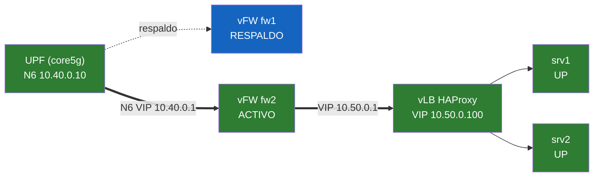

# Estado de las VNFs - 2026-10-21 19:30:49

Cadena de servicios (SFC): UE -> UPF -> vFW activo -> vLB -> servidores industriales.

| VNF | Rol / estado | Gestion |
|---|---|---|
| fw1 (nftables) | RESPALDO | 192.168.122.51 |
| fw2 (nftables) | ACTIVO | 192.168.122.52 |
| lb (HAProxy) | ACTIVO | 192.168.122.53 |
| srv1 (servidor) | UP | 192.168.122.54 |
| srv2 (servidor) | UP | 192.168.122.55 |
